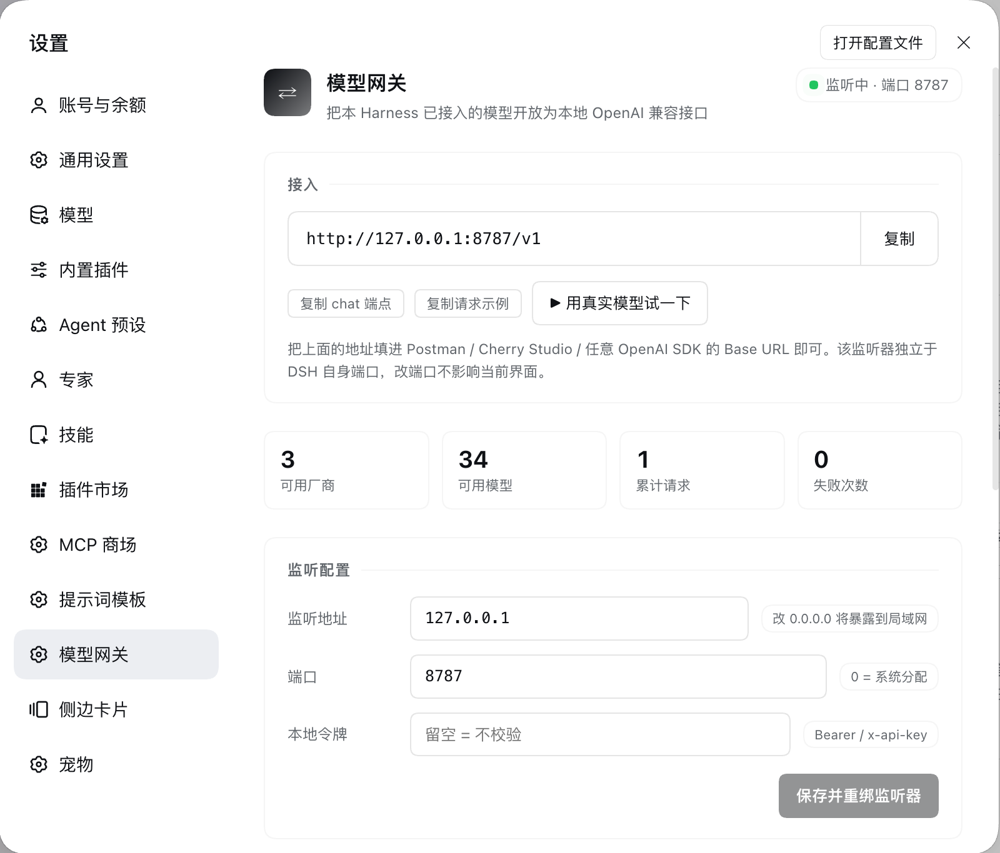
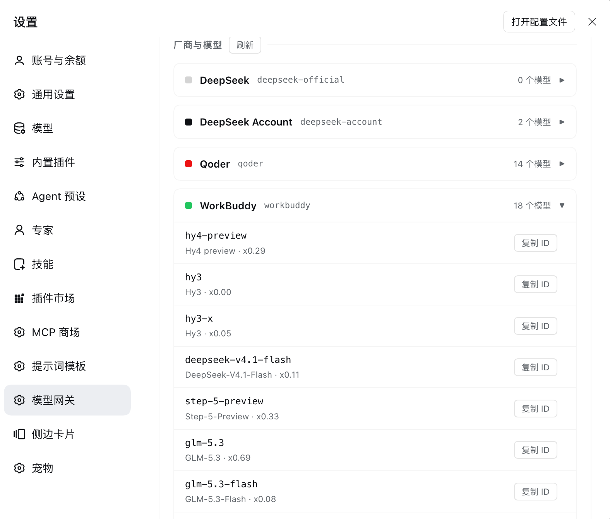

# dsh-model-gateway

把 [DeepSeek Harness](https://deepseek.com) **已经接入的模型**（WorkBuddy、Qoder、DeepSeek 账号等）一键开放成本地 **OpenAI 兼容 HTTP 接口**。

装上插件、打开 DSH，接口就在。Postman、Cherry Studio、LobeChat、LangChain、`openai` SDK……凡是支持 OpenAI 格式的工具，改一个 `base_url` 就能直接用，无需适配任何私有协议。

```
你的工具 ──OpenAI 格式──▶ dsh-model-gateway ──ctx.llm──▶ DSH 已注册的模型适配器 ──▶ 上游
                        （本插件，只做格式翻译）        （WorkBuddy / Qoder，协议由它们负责）
```

## 它解决什么问题

WorkBuddy 和 Qoder 都不是标准的 OpenAI 接口：前者有自有鉴权头、会话三连 ID 和强制流式，后者要 jobToken 交换和自定义编码。自己写转发服务，等于维护两份会持续腐坏的协议副本。

本插件是 DSH 的一个进程内插件：**协议细节全部交给 DSH 已有的模型适配器**，插件本身只做「OpenAI 格式 ↔ DSH 模型流」的翻译。上游改协议时，跟着 DSH 适配器升级即可，这里不用动。

## 截图

**设置页 —— 一键复制 Base URL、改端口、试连真实模型：**

<p align="center">
  
</p>

**厂商与模型 —— 按厂商分组展示全部可用模型，支持单独复制模型 ID：**

<p align="center">
  
</p>

## 环境要求

- [DeepSeek Harness](https://deepseek.com)（桌面版）
- 至少一家已登录的模型源：WorkBuddy、Qoder 或 DeepSeek 账号

## 安装

```bash
git clone https://github.com/Tomriy/dsh-model-gateway.git
```

然后把 `dsh-model-gateway` 目录作为本地插件包安装进 DSH 的 profile（DSH 插件管理器的「本地安装」入口，指向该目录即可）。安装成功后重启 DSH，设置面板会出现 **「模型网关」** 页。

<details>
<summary>手动安装（了解插件机制时可用）</summary>

1. 把本目录链接或复制到 profile 的 `node_modules` 下：

```bash
ln -s "$PWD/dsh-model-gateway" ~/.dsh/profiles/<你的profile>/node_modules/dsh-model-gateway
```

2. 在 profile 的 `cordis.patch.yml` 追加：

```yaml
- insert:
    - id: dsh-model-gateway
      name: dsh-model-gateway
```

3. 重启 DSH。
</details>

## 快速开始

1. 打开 DSH → **设置 → 模型网关**
2. 一键复制 **Base URL**（默认 `http://127.0.0.1:8787/v1`）
3. 填进任意 OpenAI 兼容工具，开调

也可以顺手把仓库里的 [`postman_collection.json`](postman_collection.json) 导入 Postman，请求示例都是现成的。

## 发请求

所有请求都是标准 OpenAI Chat Completions 格式。唯一的约定是模型名：**`厂商/模型ID`**。

**非流式**

```bash
curl http://127.0.0.1:8787/v1/chat/completions \
  -H 'Content-Type: application/json' \
  -d '{
    "model": "workbuddy/deepseek-v4.1-flash",
    "messages": [
      {"role": "system", "content": "你是一个简洁的助手。"},
      {"role": "user", "content": "用一句话解释什么是 API 网关"}
    ],
    "stream": false
  }'
```

响应：

```json
{
  "id": "chatcmpl-4d8b47a3ea1c",
  "object": "chat.completion",
  "model": "workbuddy/deepseek-v4.1-flash",
  "choices": [{
    "index": 0,
    "message": {
      "role": "assistant",
      "content": "API 网关是客户端与后端服务之间的统一入口，负责路由、鉴权与协议转换。",
      "reasoning_content": "……（思维链，单独字段，不混入 content）"
    },
    "finish_reason": "stop"
  }],
  "usage": {"prompt_tokens": 39, "completion_tokens": 66, "total_tokens": 105}
}
```

**流式（SSE）**

```bash
curl -N http://127.0.0.1:8787/v1/chat/completions \
  -H 'Content-Type: application/json' \
  -d '{"model":"workbuddy/deepseek-v4.1-flash","messages":[{"role":"user","content":"数到3"}],"stream":true}'
```

输出为标准 OpenAI chunk 流，`data: {...}` 逐块推送，`data: [DONE]` 收尾；思维链走 `delta.reasoning_content`，与正文分离。

**OpenAI SDK（Python）**

```python
from openai import OpenAI

client = OpenAI(base_url="http://127.0.0.1:8787/v1", api_key="local")  # 未设 apiKey 时任意占位即可

stream = client.chat.completions.create(
    model="qoder/Efficient",   # 换厂商只改前缀
    messages=[{"role": "user", "content": "你好"}],
    stream=True,
)
for chunk in stream:
    delta = chunk.choices[0].delta
    if delta.content:
        print(delta.content, end="", flush=True)
```

**查可用模型**

```bash
curl http://127.0.0.1:8787/v1/models
```

## 模型命名规则

```
workbuddy/deepseek-v4.1-flash   ← 推荐写法：厂商前缀，永远不含糊
deepseek-v4.1-flash             ← 裸名：仅当该模型只属于一家厂商时接受
```

不同厂商可能提供同名模型。裸名撞车时网关**不会猜**，直接返回 400 并列出候选：

```json
{
  "error": {
    "message": "model \"deepseek-v4-pro\" is advertised by more than one provider; qualify it as provider/model",
    "code": "model_not_found",
    "candidates": ["deepseek-account/deepseek-v4-pro", "workbuddy/deepseek-v4-pro"]
  }
}
```

## API 一览

| 方法 | 路径 | 说明 |
| --- | --- | --- |
| GET | `/v1/models` | OpenAI 格式模型列表 |
| POST | `/v1/chat/completions` | 聊天补全（流式 / 非流式） |
| GET | `/v1/gateway/providers` | 诊断：厂商、模型清单、请求统计、监听地址 |

## 设置页

**设置 → 模型网关**，一页搞定：

- **Base URL 一键复制**：另有「复制 chat 端点」「复制请求示例」快捷按钮
- **用真实模型试一下**：发一次最小请求，直接显示耗时和回复，验证链路
- **监听配置**：改 host / 端口 / 本地令牌，保存后自动重绑监听器，**无需重启 DSH**，也不影响 DSH 自身界面
- **厂商与模型**：按厂商折叠分组，跨厂商重名的模型会标出「需写全厂商名」

## 配置项

设置页改的值会持久化到 profile 的 `cordis.patch.yml`，也可直接编辑：

| 字段 | 默认 | 说明 |
| --- | --- | --- |
| `enabled` | `true` | 关闭后监听器停止、路由卸载 |
| `host` | `127.0.0.1` | 监听地址。改成 `0.0.0.0` 会暴露到局域网，风险自担 |
| `port` | `8787` | 监听端口，`0` 表示由系统分配空闲端口 |
| `apiKey` | `''` | 留空不校验；设置后请求需带 `Authorization: Bearer <key>` 或 `x-api-key` |
| `providers` | `[]` | 暴露的厂商白名单，空 = 全部 |
| `allowBareModelId` | `true` | 是否允许不带厂商前缀的裸模型名 |
| `requestTimeoutMs` | `300000` | 单次调用的模型侧超时，`0` = 不限 |

## 字段映射说明

| OpenAI 侧 | 处理 |
| --- | --- |
| `system` / `developer` 消息 | 交给 DSH 的 systemPrompt 通道，保留系统提示语义 |
| 思维链输出 | 映射到 `reasoning_content`（流式 `delta.reasoning_content`），与正文分离 |
| `usage` | `prompt_tokens` / `completion_tokens` / `total_tokens` |
| `finish_reason` | `stop` / `tool_calls` / `length` 标准映射 |
| 上游中途失败 | 已有产出则补发一帧 `{error}` 再 `[DONE]`；无产出则返回标准错误信封 |
| `top_p` 等采样参数 | DSH 暂无对应字段，收到后忽略（不假装支持） |

## 工具调用（Function Calling）

支持标准的 OpenAI 工具调用协议：`tools` 定义透传，模型决策以标准 `tool_calls` 格式回传，`finish_reason` 正确映射为 `tool_calls`。

**第一轮：带 tools 定义，模型决定调用工具**

```bash
curl http://127.0.0.1:8787/v1/chat/completions \
  -H 'Content-Type: application/json' \
  -d '{
    "model": "qoder/Efficient",
    "messages": [{"role": "user", "content": "北京天气怎么样？用 get_weather 查"}],
    "tools": [{
      "type": "function",
      "function": {
        "name": "get_weather",
        "description": "查询城市天气",
        "parameters": {"type": "object", "properties": {"city": {"type": "string"}}, "required": ["city"]}
      }
    }]
  }'
```

```json
{
  "choices": [{
    "message": {
      "role": "assistant",
      "content": "",
      "tool_calls": [{"id": "call_4329...", "type": "function", "function": {"name": "get_weather", "arguments": "{\"city\": \"北京\"}"}}]
    },
    "finish_reason": "tool_calls"
  }]
}
```

**第二轮：执行工具后回传结果**（`role: "assistant"` 带 `tool_calls`，`role: "tool"` 带结果）：

```json
{
  "model": "qoder/Efficient",
  "messages": [
    {"role": "user", "content": "北京天气怎么样？"},
    {"role": "assistant", "content": "", "tool_calls": [{"id": "call_4329", "type": "function", "function": {"name": "get_weather", "arguments": "{\"city\": \"北京\"}"}}]},
    {"role": "tool", "tool_call_id": "call_4329", "content": "{\"temp_c\": 12, \"condition\": \"晴\"}"}
  ],
  "tools": ["...同上..."]
}
```

### 工具历史兼容模式（重要）

实测发现：**部分上游网关对 OpenAI 工具历史回放（`tool_calls` + `tool` 消息）支持不完整**——第二轮的 `role: "tool"` 结果可能被上游丢弃，模型看到的是"工具没有返回结果"。各家上游表现不一（同一厂商不同模型也不一致：有的静默吞掉，有的直接报 502）。

为此提供 `compatTools` 配置：

| 值 | 行为 | 适用 |
| --- | --- | --- |
| `native`（默认） | 标准 OpenAI 工具历史透传 | 上游完整支持工具回放时，语义最准 |
| `text` | 工具调用与结果**折叠成纯文本对话**（`[调用工具 get_weather，参数 {...}]` / `[工具 xxx 返回结果]: ...`） | 上游吞工具结果时的 100% 兼容兜底 |

**实测矩阵（2026-10-29，两轮全流程验证）**：

| 场景 | native 模式 | text 模式 |
| --- | --- | --- |
| Round 1：tools 定义 → `tool_calls` 回传 | ✅ qoder + workbuddy 都正常 | ✅ 正常 |
| Round 2：`role:"tool"` 结果回传 → 最终答案 | ❌ **两家上游都吞掉结果**（模型答"工具没返回数据"） | ✅ **模型正确复述工具结果**（温度/天气/湿度全对） |
| 流式 `tool_calls` delta 分片拼装 | ✅ id/name/arguments 完整 | ✅ |
| 多工具选择 / 并行调用 / `is_error` 标记 | ✅ | ✅ |

结论：**做 agent 类应用请直接用 `text` 模式**——它跳过上游不可靠的工具历史回放，把调用过程折叠成模型 100% 能读的文本。

## 客户端兼容性实测

用官方 `openai` Python SDK（v2.48.0）与 LangChain 实测通过的能力：

| 场景 | SDK 写法 | 结果 |
| --- | --- | --- |
| 基础对话 | `chat.completions.create(...)` | ✅ content / finish_reason / usage / id 全部标准形状 |
| 流式 | `stream=True` + `stream_options={"include_usage": True}` | ✅ delta 逐块、usage 帧正确 |
| 多轮历史 | messages 列表 | ✅ |
| 图片输入 | `content: [{type:"image_url"}, {type:"text"}]` | ✅（需选支持图片的模型） |
| 模型列表 | `client.models.list()` | ✅ |
| 工具调用（Round 1） | `tools=[...]` | ✅ `finish_reason: "tool_calls"`，SDK 自动解析 |
| 流式工具调用 | `stream=True` + `delta.tool_calls` 拼装 | ✅ |
| **完整 agent 循环（Round 2）** | `messages.append(m.model_dump())` + `role:"tool"` | ✅ **text 模式**下结果可见；native 模式受上游限制 |
| LangChain | `ChatOpenAI(base_url=...)` | ✅ |

```python
from openai import OpenAI

client = OpenAI(base_url="http://127.0.0.1:8787/v1", api_key="anything")

# 工具调用 agent 循环（建议 compatTools: text）
tools = [{"type": "function", "function": {"name": "get_weather", "description": "查城市天气",
    "parameters": {"type": "object", "properties": {"city": {"type": "string"}}, "required": ["city"]}}}]

messages = [{"role": "user", "content": "广州天气怎么样？"}]
resp = client.chat.completions.create(model="qoder/Efficient", messages=messages, tools=tools)
msg = resp.choices[0].message                      # msg.tool_calls → 执行你的工具
messages.append(msg.model_dump())                  # SDK 标准回放方式
messages.append({"role": "tool", "tool_call_id": msg.tool_calls[0].id, "content": "广州晴 24°C"})
final = client.chat.completions.create(model="qoder/Efficient", messages=messages, tools=tools)
print(final.choices[0].message.content)
```

两种模式都通过 `POST /api/dsh-model-gateway/configure` 或设置页配置文件热切换，无需重启。若你的 agent 框架第二轮拿不到工具结果，切到 `text` 即可。

## 安全边界

- 默认只监听 `127.0.0.1`，**不暴露局域网与公网**
- 凭据不经过本插件：调用走 DSH 内部的 `ctx.llm`，token 由 WorkBuddy / Qoder 插件各自保管
- 客户端断开时立刻取消上游请求，不白烧额度
- 本插件绝不主动刷新上游 token（刷新会轮换 refreshToken，把你正在用的登录态顶下线）

## 图片输入

模型是否支持图片由 DSH 的模型目录决定（同一厂商的不同模型也可能不同）。网关按此分流：

**不支持图片的模型** —— 明确 400 并指名模型，绝不静默丢图：

```json
{
  "error": {
    "message": "model \"workbuddy/glm-5.3\" does not support image input. Pick an image-capable model (see GET /v1/models), or send text only.",
    "code": "model_does_not_support_image"
  }
}
```

**支持图片的模型** —— 标准 OpenAI 多模态格式直接可用（base64 data URL）：

```bash
curl http://127.0.0.1:8787/v1/chat/completions \
  -H 'Content-Type: application/json' \
  -d '{
    "model": "qoder/Efficient",
    "messages": [{
      "role": "user",
      "content": [
        {"type": "text", "text": "这张图是什么颜色？一个词回答"},
        {"type": "image_url", "image_url": {"url": "data:image/png;base64,iVBORw0KGgo..."}}
      ]
    }],
    "stream": false
  }'
```

```json
{"choices": [{"message": {"role": "assistant", "content": "红色"}}], "usage": {"prompt_tokens": 399, "completion_tokens": 55, "total_tokens": 454}}
```

图片以 base64 data URL 传入（`image/png` / `image/jpeg` / `image/webp` / `image/gif`），由 DSH 的附件服务校验、归一化后进入模型请求。`http(s)://` 外链图片不支持（避免网关代拉任意 URL 的 SSRF 面），会返回明确错误。

哪些模型支持图片：`GET /v1/models` 响应里带 `"image_input": true` 标记的就是。

## 端口被占用怎么办

配置的端口被其他进程占用时，网关**自动回退到系统分配的空闲端口**，不会拒绝启动。设置页顶部会红字提示实际端口；也可以在设置页换一个端口重新保存。

## 已知限制

- 依赖 DSH 的模型适配器能力，`temperature` / `max_tokens` / `stop` 之外的控制参数以 DSH 实际支持为准
